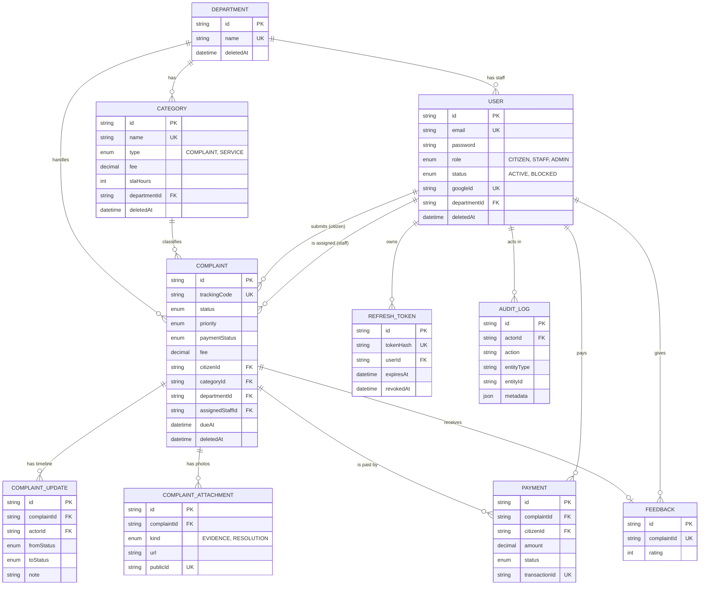
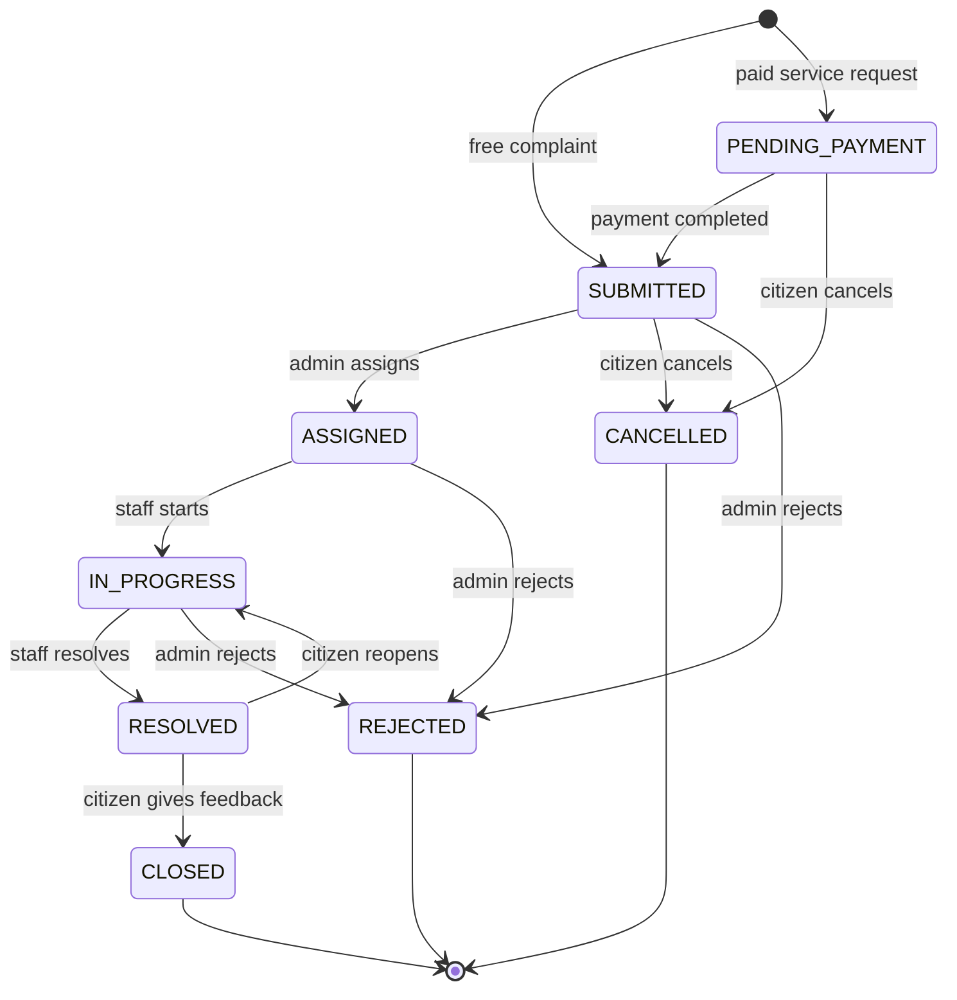

# CityCare Backend

**City Complaint & Service Request Platform**

CityCare is a backend API for a city. A citizen reports a problem (a pothole, a broken street light, garbage that was not collected) or asks for a paid city service (bulk waste pickup, septic tank cleaning). The complaint goes to the right department, an admin assigns it to a staff member, the staff member resolves it and the citizen gives feedback. Every step is saved, so the citizen can follow the complaint with a tracking code.

All features work from Postman or Swagger. The CityCare frontend (Next.js) is built on top of this API.

## Links

| Item | Link |
| --- | --- |
| Live API | https://citycare-backend.vercel.app |
| API Docs (Swagger) | https://citycare-backend.vercel.app/api/v1/docs |
| Health Check | https://citycare-backend.vercel.app/api/v1/health |
| Postman Collection | [postman/CityCare.postman_collection.json](./postman/CityCare.postman_collection.json) |

## Demo Credentials

The seed script creates these accounts.

| Role | Email | Password |
| --- | --- | --- |
| Admin | admin@citycare.com | Admin12345 |
| Staff (Roads & Transport) | roads.staff@citycare.com | Staff12345 |
| Citizen | citizen@citycare.com | Citizen12345 |

The seed also adds more staff members (one per department), more citizens (`citizen2@citycare.com` to `citizen6@citycare.com`, same password) and a few weeks of past complaints, so the dashboards have real history.

Stripe is in test mode. Pay with the card `4242 4242 4242 4242`, any future date and any CVC.

## The Problem

In many cities a citizen does not know where to report a problem, and after reporting nobody knows what happened to it. The city also has no clear picture of which department is slow and which area has the most problems.

CityCare solves this with one place for all complaints, automatic routing to the department, a clear status for every complaint, a time limit (SLA) for every category and reports for the admin.

## Roles

| Role | What this role can do |
| --- | --- |
| **Citizen** | Register and login, submit complaints and service requests, upload photos, pay the service fee, track, cancel, reopen and give feedback |
| **Staff** | See the complaints that are assigned to them, start the work, resolve with a note, upload proof photos, pause new jobs while on leave |
| **Admin** | Manage departments, categories and users, assign and transfer complaints, reject complaints, answer contact messages, see statistics and audit logs |

A citizen registers by themselves. Staff and admin accounts are created by an admin.

## Features

- Email and password login, Google login, JWT access token and refresh token rotation
- Role based access for the 3 roles on every protected route
- Departments and categories. A category belongs to a department, so a new complaint goes to the right department automatically
- Free complaints and paid service requests
- Complaint list with search, filters, sorting and pagination
- Public tracking page data with a tracking code, without personal data
- Assignment by the admin, or automatic assignment to the staff member with the fewest active complaints
- A staff member has a capacity limit. Concurrent assignments cannot go over the limit
- Staff can pause new jobs while on leave. Automatic and manual assignment skip them
- Status workflow with a timeline: who changed what and when
- SLA due date for every complaint and an overdue filter
- Cancel, reopen (within 7 days, 2 times at most) and transfer to another department
- Feedback with a rating that closes the complaint
- Stripe Checkout payment with webhook, success and cancel callbacks, verification and payment history
- Automatic refund when a paid request is rejected or cancelled
- Photo upload with Multer and Cloudinary
- Email notifications with Nodemailer and password reset by email
- Soft delete for users, departments, categories, complaints and photos
- Audit log of every important action
- Redis cache for the public lists and the statistics, Redis based rate limiting
- Statistics for the public, for each role and for the admin dashboard, with a 30 day trend and weekly staff performance
- Contact form inbox. Admins reply by email from the dashboard
- Works behind a server side frontend: with a shared key the API rate limits by the real client IP

## Tech Stack

| Part | Technology |
| --- | --- |
| Runtime and framework | Node.js, TypeScript, Express 5 |
| Package manager and build | Bun, tsup |
| Database | PostgreSQL with Prisma ORM |
| Validation | Zod |
| Authentication | Custom JWT, bcrypt, Google OAuth (google-auth-library) |
| Payment | Stripe Checkout |
| Cache and rate limit | Redis (ioredis, express-rate-limit, rate-limit-redis) |
| File upload | Multer, Cloudinary |
| Email | Nodemailer |
| Security | helmet, CORS allow list, rate limiting |
| Lint and format | Biome |
| Docs | Swagger (OpenAPI), Postman |
| Deployment | Vercel |

## Architecture

Every request goes the same way:

```text
Route  ->  Middlewares (rate limit, auth, role, validation)  ->  Controller  ->  Service  ->  Prisma  ->  PostgreSQL
```

- The **route** file says which middlewares run and which controller handles the request
- The **controller** reads the request and sends the response. It has no business logic
- The **service** has the business logic and talks to the database
- All errors go to one global error handler, so every error has the same shape

```text
prisma
├── migrations
├── schema.prisma
└── seed.ts
src
├── app.ts
├── server.ts
├── config              environment variables, checked with Zod at startup
├── docs                Swagger document and docs route
├── errors              AppError class
├── lib                 prisma, redis, stripe, google, mailer, cloudinary clients
├── middlewares         auth, validation, rate limit, upload, error handler
├── modules
│   ├── auth            register, login, tokens, password reset, google login
│   ├── user            own profile
│   ├── department
│   ├── category
│   ├── complaint       complaints, assignment, workflow, photos
│   ├── payment         checkout, settlement (webhook), refund, history
│   ├── stats
│   ├── admin           user management
│   ├── audit           audit log
│   └── notification    email templates and sending
├── routes
├── utils               response, pagination, cache, jwt, password, audit helper
└── validations
```

## Database Design



- **Constraints**: unique email, tracking code, token hash and Stripe session id. Check constraints in the database for the fee, the SLA hours, the rating (1 to 5), the payment amount and the coordinates
- **Indexes**: on the columns of the filters, for example `(citizenId, status)`, `(assignedStaffId, status)`, `(departmentId, status)`, `(status, dueAt)`, `area` and `createdAt`
- **Transactions**: every status change saves the complaint, the timeline row and the audit log together. Assignment, payment settlement and refund lock the complaint row with `SELECT ... FOR UPDATE`, so two requests cannot change the same complaint at the same time
- **Soft delete**: a `deletedAt` column. Deleted rows stay in the database and are hidden from every query
- **Migrations and seed**: 8 migrations in `prisma/migrations` and a seed script with an admin, 5 departments, 12 categories, demo users and sample complaints

## Complaint Workflow



A status change that is not in this diagram is refused with `409`. When a paid request is rejected or cancelled, the fee is refunded through Stripe.

## Payment Flow

1. The citizen creates a service request. Its status is `PENDING_PAYMENT`
2. `POST /payments/initiate` creates a Stripe Checkout session and returns `checkoutUrl`
3. The citizen pays on the Stripe page
4. Stripe sends the citizen to `GET /payments/success?session_id=...`. The server asks Stripe if the session is really paid, and only then completes the payment. If the citizen leaves the Stripe page, Stripe sends them to `GET /payments/cancel`
5. Stripe also calls `POST /payments/webhook`. The signature is verified. So the payment is saved even if the citizen closes the browser
6. The payment becomes `COMPLETED`, the request becomes `SUBMITTED` and the SLA time starts
7. `GET /payments` and `GET /payments/:id` show the status. Settlement is idempotent: the callback, the webhook and the verify endpoint can all arrive and the payment is completed only once

A frontend can send `clientUrl` to `POST /payments/initiate`. Then Stripe sends the user back to the frontend, and the frontend calls `POST /payments/verify`.

## API Response Format

Success:

```json
{
    "success": true,
    "message": "Complaints retrieved successfully",
    "meta": { "page": 1, "limit": 10, "total": 25, "totalPages": 3 },
    "data": []
}
```

Error:

```json
{
    "success": false,
    "message": "Validation failed",
    "errors": [{ "field": "email", "message": "A valid email is required" }]
}
```

Protected routes need the header `Authorization: Bearer <accessToken>`.

## API Endpoints

Base URL: `/api/v1`

The API has 60 endpoints.

### Auth

| Method | Endpoint | Access | Description |
| --- | --- | --- | --- |
| POST | `/auth/register` | Public | Register a citizen account |
| POST | `/auth/login` | Public | Login with email and password |
| POST | `/auth/refresh-token` | Public | Get a new access token |
| POST | `/auth/logout` | Public | Logout and revoke the refresh token |
| POST | `/auth/change-password` | Any logged in user | Change own password |
| POST | `/auth/forgot-password` | Public | Send a password reset email |
| POST | `/auth/reset-password` | Public | Set a new password with the reset token |
| GET | `/auth/google` | Public | Start the Google login |
| GET | `/auth/google/callback` | Public | Google sends the user back here |
| POST | `/auth/google` | Public | Login with a Google ID token |
| POST | `/auth/google/exchange` | Public | Exchange the one time Google login code for tokens |

### Users

| Method | Endpoint | Access | Description |
| --- | --- | --- | --- |
| GET | `/users/me` | Any logged in user | Get own profile |
| PATCH | `/users/me` | Any logged in user | Update own profile |

### Departments

| Method | Endpoint | Access | Description |
| --- | --- | --- | --- |
| GET | `/departments` | Public | Get all departments |
| GET | `/departments/:id` | Public | Get one department with its categories |
| POST | `/departments` | Admin | Create a department |
| PATCH | `/departments/:id` | Admin | Update a department |
| DELETE | `/departments/:id` | Admin | Remove a department (soft delete) |

### Categories

| Method | Endpoint | Access | Description |
| --- | --- | --- | --- |
| GET | `/categories` | Public | Get complaint and service categories |
| GET | `/categories/:id` | Public | Get one category |
| POST | `/categories` | Admin | Create a category |
| PATCH | `/categories/:id` | Admin | Update a category |
| DELETE | `/categories/:id` | Admin | Remove a category (soft delete) |

### Complaints

| Method | Endpoint | Access | Description |
| --- | --- | --- | --- |
| POST | `/complaints` | Citizen | Submit a complaint or a service request |
| GET | `/complaints` | Any logged in user | List complaints with search, filters, sorting and pagination |
| GET | `/complaints/track/:trackingCode` | Public | Track a complaint with its tracking code |
| GET | `/complaints/:id` | Any logged in user | Get complaint details with the timeline |
| PATCH | `/complaints/:id` | Citizen or Admin | Update a complaint |
| DELETE | `/complaints/:id` | Citizen or Admin | Remove a complaint (soft delete) |
| POST | `/complaints/:id/assign` | Admin | Assign a complaint to a staff member |
| PATCH | `/complaints/:id/status` | Staff or Admin | Change the status of a complaint |
| POST | `/complaints/:id/cancel` | Citizen | Cancel own complaint before it is assigned |
| POST | `/complaints/:id/reopen` | Citizen | Reopen a resolved complaint |
| POST | `/complaints/:id/transfer` | Admin | Transfer a complaint to another department |
| POST | `/complaints/:id/feedback` | Citizen | Give feedback on a resolved complaint |
| POST | `/complaints/:id/attachments` | Any logged in user | Upload images to a complaint |
| DELETE | `/complaints/:id/attachments/:attachmentId` | Any logged in user | Remove an image from a complaint |

### Payments

| Method | Endpoint | Access | Description |
| --- | --- | --- | --- |
| POST | `/payments/initiate` | Citizen | Create a Stripe Checkout session for a service request |
| GET | `/payments/success` | Public | Stripe sends the user here after a successful payment |
| GET | `/payments/cancel` | Public | Stripe sends the user here when the checkout is cancelled |
| POST | `/payments/verify` | Citizen | Verify a checkout session with Stripe |
| POST | `/payments/webhook` | Stripe | Stripe webhook |
| GET | `/payments` | Citizen or Admin | Get the payment history |
| GET | `/payments/:id` | Citizen or Admin | Get one payment |
| POST | `/payments/:id/refund` | Admin | Refund a payment of a rejected or cancelled request |

### Stats

| Method | Endpoint | Access | Description |
| --- | --- | --- | --- |
| GET | `/stats/public` | Public | Get public statistics |
| GET | `/stats/me` | Any logged in user | Get the numbers for the dashboard of the logged in user |

### Contact

| Method | Endpoint | Access | Description |
| --- | --- | --- | --- |
| POST | `/contact` | Public | Send a message to the city team |

### Admin

| Method | Endpoint | Access | Description |
| --- | --- | --- | --- |
| GET | `/admin/users` | Admin | Get all users with search, filters and pagination |
| POST | `/admin/users` | Admin | Create a staff or admin account |
| PATCH | `/admin/users/:id/role` | Admin | Change the role of a user |
| PATCH | `/admin/users/:id/status` | Admin | Block or unblock a user |
| DELETE | `/admin/users/:id` | Admin | Remove a user (soft delete) |
| GET | `/admin/staff-workload` | Admin | Get the staff members with their active complaints |
| GET | `/admin/dashboard-stats` | Admin | Get the platform statistics |
| GET | `/admin/audit-logs` | Admin | Get the audit logs |
| GET | `/admin/messages` | Admin | Get the contact messages |
| POST | `/admin/messages/:id/reply` | Admin | Reply to a contact message by email |
| PATCH | `/admin/messages/:id/status` | Admin | Close or reopen a contact message |

### System

| Method | Endpoint | Access | Description |
| --- | --- | --- | --- |
| GET | `/health` | Public | Check the API, the database and redis |

## Security

- Passwords are hashed with bcrypt. Refresh tokens and reset tokens are stored as SHA-256 hashes
- Access tokens are short lived JWTs. Refresh tokens are rotated on every use. Parallel requests may use the same token for a few seconds, after that a reused token revokes the session
- helmet security headers, a CORS allow list and a JSON body size limit
- Rate limiting on every route and a stricter limit on the auth routes. The counters are in Redis, so the limit is shared between serverless instances
- Zod validation on every body, query and path parameter
- The Stripe webhook signature is verified. Uploaded files are checked by their real content, not only by the file name

## Run It Locally

You need Bun, Node.js 24 and a PostgreSQL database. Redis is optional.

```bash
git clone https://github.com/ebrahim2355/citycare-backend.git
cd citycare-backend
bun install
```

Create a `.env` file from `.env.example` and set at least `DATABASE_URL` and `JWT_ACCESS_SECRET`.

```bash
bunx prisma generate
bunx prisma migrate deploy
bun run seed
bun run dev
```

The API runs on http://localhost:5000 and the docs are on http://localhost:5000/api/v1/docs.

### Scripts

| Script | What it does |
| --- | --- |
| `bun run dev` | Starts the dev server with reload |
| `bun run build` | Bundles the project with tsup into `dist` |
| `bun run start` | Runs the built server |
| `bun run seed` | Adds the admin, the departments, the categories and the demo data |
| `bun run migrate` | Creates and applies a migration in development |
| `bun run migrate:deploy` | Applies the migrations in production |
| `bun run typecheck` | Checks the types |
| `bun run lint` | Runs Biome |

### Environment Variables

| Variable | Needed | Description |
| --- | --- | --- |
| `DATABASE_URL` | Yes | PostgreSQL connection string |
| `JWT_ACCESS_SECRET` | Yes | A random string of at least 32 characters |
| `APP_URL` | In production | Public URL of this API. Used for the Google and Stripe callbacks |
| `REDIS_URL` | No | Redis for the cache and the rate limit. Without it the cache is off and the limit is kept in memory |
| `STRIPE_SECRET_KEY`, `STRIPE_WEBHOOK_SECRET` | For payments | Stripe test keys |
| `GOOGLE_CLIENT_ID`, `GOOGLE_CLIENT_SECRET` | For Google login | OAuth client from the Google Cloud console |
| `EMAIL_USER`, `GOOGLE_APP_PASSWORD` | For emails | Gmail address and its app password |
| `EMAIL_SKIP_DOMAINS` | No | Domains that never get an email. Set it to `citycare.com` so the demo accounts do not send mail to a real domain |
| `CLOUDINARY_CLOUD_NAME`, `CLOUDINARY_API_KEY`, `CLOUDINARY_API_SECRET` | For photo upload | Cloudinary keys |
| `CLIENT_URL`, `CORS_ORIGINS` | No | Frontend URL and the allowed origins |
| `INTERNAL_API_KEY` | With a frontend server | Shared with the frontend server. When a request has this key in `x-internal-key`, the API uses `x-client-ip` for the rate limit and the logs, because every request of a server side frontend comes from the same IP |

The other variables in `.env.example` have good default values. A feature that has no keys answers with `503` and a clear message. The rest of the API keeps working.

## Deployment on Vercel

```bash
bun run build
vercel --prod
```

`vercel.json` sends every request to `dist/server.js`. Set the environment variables in the Vercel project, then run the migrations and the seed against the production database:

```bash
bunx prisma migrate deploy
bun run seed
```

After the deploy:

- Stripe: add a webhook for `<APP_URL>/api/v1/payments/webhook` with the events `checkout.session.completed`, `checkout.session.expired` and `charge.refunded`
- Google: add `<APP_URL>/api/v1/auth/google/callback` as an authorized redirect URI of the OAuth client

The project follows the serverless rules: no cron jobs, no WebSockets, no files on the local disk and no state in memory. Shared state is in PostgreSQL and Redis.
